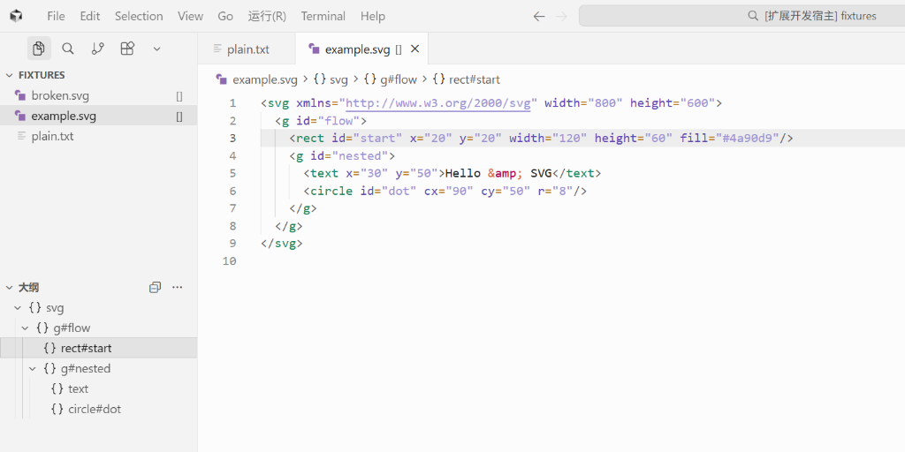
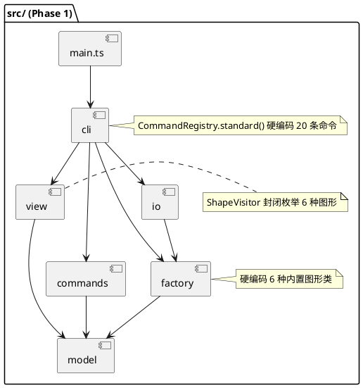
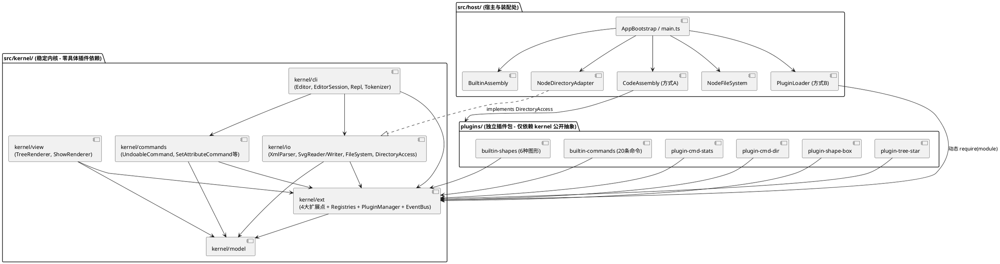

# Lab1 Phase 2：插件实践与插件式重构 — 项目文档

> **作者**：刘桃宏（24300240029）
> **仓库运行**：
> - CLI 构建与测试：`npm test`（88 项自动化测试：架构规则、Phase 1 回归、加载器失败路径、属性事务、`stats`/`dir`/`box`/`modified-star` 插件与双装配逐字节一致性）
> - CLI 启动（方式 A 代码装配）：`node dist/src/main.js`
> - CLI 启动（方式 B 配置装配）：`node dist/src/main.js --config plugins.config.json`
> - CLI 基线兼容（禁用可选插件）：`node dist/src/main.js --no-plugins`
> - VSCode 扩展测试：`npm --prefix vscode-svg-extension test`（6 项单元测试）
> - 度量脚本：`node scripts/generate-metrics.mjs`（输出至 `docs/metrics/`）

---

## 第一部分：VSCode 插件实践

### 1.1 扩展结构与启动步骤

扩展位于独立目录 `vscode-svg-extension/`，零第三方运行时依赖：

- `src/extension.ts`：扩展入口 `activate` / `deactivate`，向 VSCode 注册两个 Provider；
- `src/SvgBadgeRule.ts` & `src/SvgFileDecorationProvider.ts`：实现 Explorer 中 `.svg` 普通文件的 `[]` 徽标装饰；
- `src/SvgOutlineNode.ts`、`src/SvgOutlineParser.ts` & `src/SvgDocumentSymbolProvider.ts`：实现带精确字符偏移的 XML/SVG 解析器与 VSCode 原生 Outline 符号提供器；
- `fixtures/`：`example.svg`（嵌套分组、有/无 `id` 元素）、`plain.txt`（非 SVG 对照文件）、`broken.svg`（不完整 XML 容错对照）；
- `test/extension.test.ts`：覆盖 `.svg` 标记规则、目录/非 SVG 过滤、嵌套大纲、无 `id` 节点、源码行号定位、编辑后刷新与不完整 XML 清空不崩溃。

**安装、编译与启动**：
```bash
cd vscode-svg-extension
npm install
npm run compile
npm test
```
在 VSCode（或兼容宿主）中打开 `vscode-svg-extension/` 目录并按 `F5`（已配置 `.vscode/launch.json`），将启动加载了 `fixtures/` 的 Extension Development Host：
1. 在 Explorer 中可见 `example.svg` 右侧显示 `[]`，`plain.txt` 与目录无标记，且文件名与文件内容不变；
2. 打开 `example.svg`，展开左下角 **Outline（大纲）** 视图，可见 `svg → g#flow → rect#start / g#nested → text / circle#dot`，点击 `rect#start` 精准跳转到第 3 行源码；编辑文本时大纲自动更新；打开 `broken.svg` 时大纲安全清空且扩展不崩溃。

**真实运行效果截图**：

![SVG 文件 [] 标记效果](images/vscode-svg-badge.png)

*图 1.1：扩展开发宿主窗口中，Explorer 为 `example.svg` 与 `broken.svg` 附加 `[]` 标记，普通文件 `plain.txt` 无标记，文件名与内容保持不变。*



*图 1.2：左下角原生大纲展示 `svg → g#flow → rect#start / g#nested → text / circle#dot` 嵌套层级（无 `id` 的 `<text>` 显示为 `text`），点击 `rect#start` 后右侧精确高亮定位至第 3 行源码。*

### 1.2 VSCode 与插件的职责边界与注册-回调机制

| 角色 | 核心职责 |
|---|---|
| **VSCode（宿主框架）** | 管理工作区文件树 UI、编辑器缓冲与生命周期；定义扩展点接口（`FileDecorationProvider`、`DocumentSymbolProvider`）；管理激活时机（`onStartupFinished`）与资源释放（`Disposable`）；在文件刷新、打开、编辑、点击大纲节点时主动调度回调并渲染 UI。 |
| **扩展插件（`svg-editor-vscode`）** | 被动实现宿主契约接口：在 `activate(context)` 中实例化 `SvgFileDecorationProvider` 与 `SvgDocumentSymbolProvider`，通过 `vscode.window.registerFileDecorationProvider` 与 `vscode.languages.registerDocumentSymbolProvider({ pattern: '**/*.svg' }, ...)` 注册到宿主，并将返回的 `Disposable` 挂入 `context.subscriptions`。 |

**注册与控制反转（IoC）流程**：
1. 宿主启动完成后触发 `onStartupFinished`，加载 `dist/src/extension.js` 并调用 `activate(context)`；
2. 插件向宿主注册两个 Provider 后即返回，不持有任何事件循环或 UI 控件；
3. 当 Explorer 渲染文件项时，VSCode 回调 `provideFileDecoration(uri)`，仅当目标为普通文件且后缀为 `.svg` 时返回 `new vscode.FileDecoration('[]', 'SVG Vector File')`；
4. 当用户打开或编辑 `.svg` 文件时，VSCode 回调 `provideDocumentSymbols(document)`，插件解析文本并映射出嵌套的 `vscode.DocumentSymbol[]` 树（含精确 `range` 与 `selectionRange`），由 VSCode 原生 Outline 视图负责绘制与点击跳转。

### 1.3 文件装饰与经典 Decorator / Adapter 模式的对比分析

- **与 GoF Decorator（装饰器模式）的对应与差异**：
  - *相似之处*：意图都是“在不修改原有对象（磁盘文件名与文件内容）的前提下，动态为其附加额外表现/信息（Explorer 旁的 `[]` 徽标）”，且多个插件的装饰可并存。
  - *核心差异*：经典 GoF Decorator 要求装饰器与被装饰对象实现**同一接口**并通过**对象组合递归包裹**（`Decorator implements Component` 持有 `Component` 引用并转发调用）；而 VSCode 的 `FileDecorationProvider` 并非包裹 `Uri` 或文件节点对象，而是采用 **策略/数据提供者（Provider）+ 宿主合成** 机制——插件仅返回一个轻量级值对象 `FileDecoration`（`badge`、`tooltip`），由 VSCode 视图层统一合并多个 Provider 的装饰元数据并渲染。因此它更接近“受控元数据贡献点（Contribution Point）”，避免了装饰链嵌套耦合。
- **与 GoF Adapter（适配器模式）的对应与差异**：
  - 在本扩展内部，`SvgDocumentSymbolProvider` 与 `SvgFileDecorationProvider` 本身承担了明确的 **Adapter** 角色：纯领域逻辑（`SvgOutlineParser` 返回偏移量 AST `SvgOutlineNode`；`SvgBadgeRule` 仅接收 `(fsPath, isDirectory)`）作为 Adaptee 与 VSCode 运行时完全解耦；Provider 将它们适配到 VSCode 目标接口（`DocumentSymbolProvider` / `FileDecorationProvider`），完成 `offset → document.positionAt()` 到 `vscode.Range` / `vscode.DocumentSymbol` 以及 `vscode.workspace.fs.stat` 到 `isDirectory` 的转换。这样既隔离了宿主 API，又使核心逻辑可在纯 Node 环境下独立单元测试。

### 1.4 Phase 1 解析、模型与遍历代码的复用评估

| Phase 1 模块 | 能否直接复用 | 原因与评估 |
|---|---|---|
| `XmlParser`（词法与标签扫描） | **仅可借鉴思想，无法直接复用** | Phase 1 的 `XmlParser` 生成的 `XmlElement` 仅保留标签名、属性与文本，**丢弃了起始/结束字符偏移和标签名位置**，无法构造 VSCode 跳转源码所需的 `range` 与 `selectionRange`；且遇到不完整 XML 立即抛异常中断，虽可 `try/catch` 清空，但仍缺位置追踪。 |
| `SvgReader` 与 `Shape`/`SvgDocument` 模型 | **不适合复用** | Phase 1 模型只服务于编辑器支持的 6 种图形，`SvgReader` 会跳过 `<path>`、`<defs>`、`<style>` 等合法 SVG 元素，并且会对无 `id` 元素**自动分配虚拟 `id`**（如 `rect1`）并告警——这与大纲视图“如实展示全部原始 XML 标签、无 `id` 仅显示标签名”的需求相冲突。 |
| `TreeRenderer` / 遍历逻辑 | **无法直接复用** | CLI `TreeRenderer` 输出 ASCII 字符画字符串，而 VSCode 原生 Outline 要求返回层次化的 `vscode.DocumentSymbol` 对象树，渲染与交互由宿主接管。 |

因此，VSCode 扩展独立实现了面向编辑器的偏移保留解析器 `SvgOutlineParser`（约 200 行），同时保持与 Phase 1 一致的零外部依赖、面向对象一类一文件风格。

---

## 第二部分：CLI 插件式重构

### 2.1 重构前后架构对比（PlantUML）

#### Phase 1（tag `final`）架构：静态内置与两处硬编码分派



#### Phase 2（tag `p2`）三层插件式架构：内核 / 装配处 / 插件



**关键重构演进**：
1. 消除了 Phase 1 遗留的两处按名硬编码分派（`ShapeFactory` 与 `CommandRegistry.standard()`），全部迁移为独立插件包经 `PluginManager` 注册；
2. 用 `Shape.summary()` 多态替代了封闭的 6 类型 `ShapeVisitor`，新增图形无需修改内核或渲染器；
3. 建立了可执行架构护栏 `test/architecture.test.ts`：强制校验 `kernel ↛ host/plugins`、`plugins ↛ host/sibling-plugins`、`PluginLoader` 零硬编码导入、零 `switch`、一类一文件、零第三方运行依赖。

---

### 2.2 扩展点清单（§1 交付物）

| 扩展点接口 | 职责 | 内核调用位置（文件与函数） | 已有实现 | 禁用本阶段可选扩展时的缺省行为 | 违反契约时框架报错方式 |
|---|---|---|---|---|---|
| **`ShapeProvider`** (`src/kernel/ext/ShapeProvider.ts`) | 注册图形类型：定义 `create` 参数解析、`help` 语法以及 SVG 读回还原（含 `data-kind` 复合图形）。 | ① `src/kernel/ext/ShapeRegistry.ts` → `createFromArgs()`（由 `CreateHandler` 与 `GroupCommand` 调用）；<br>② `src/kernel/io/SvgReader.ts` → `readElementList()` 调用 `findSpecialized()` / `findForElement()` 与 `createFromElement()`；<br>③ `ShapeRegistry.usages()`（由 `HelpHandler` 调用）。 | 内置：`RectShapeProvider`、`CircleShapeProvider`、`EllipseShapeProvider`、`LineShapeProvider`、`TextShapeProvider`、`GroupShapeProvider`（`plugins/builtin-shapes/`）；<br>可选：`BoxShapeProvider`（`plugins/plugin-shape-box/`）。 | 仅内置 6 种图形可用；`create box ...` 报 `error: unknown shape type: box (is the plugin loaded?)`；读回 `<g data-kind="box">` 自动降级为普通 `g`。 | ① 注册空 `typeName` → 激活失败回滚并报 `error: plugin failed to activate: <name> (invalid shape provider: missing typeName)`；<br>② 重名注册 → 回滚并报 `error: duplicate registration: shapes/<typeName>`；<br>③ 与 `contributes.shapes` 不符 → 回滚并报 `error: plugin manifest mismatch: ...`；<br>④ 复合图读回重复 ID → `SvgReader.chooseId` 抛 `error: duplicate id in svg: <id>` 并保持原文档。 |
| **`Command`** (`src/kernel/ext/Command.ts`) | 注册一条 CLI 命令，提供命令名、`usage`、`summary` 与执行逻辑 `run(args, session)`。 | ① `src/kernel/cli/Editor.ts` → `execute()` 调用 `session.commands.lookup(name).run(args, session)`；<br>② `src/kernel/ext/CommandRegistry.ts` → `all()`（由 `HelpHandler` 列出命令）。 | 内置：20 条 Phase 1 命令（`plugins/builtin-commands/`）；<br>可选：`StatsCommand`（`plugins/plugin-cmd-stats/`）、`DirCommand`（`plugins/plugin-cmd-dir/`）。 | 仅内置 20 条 Phase 1 命令可用；执行 `stats` 或 `dir` 报 `error: unknown command: <name>. type 'help' for commands`，且 `help` 中不显示它们。 | ① 注册空 `name` → 激活失败回滚；<br>② 重名命令 → 回滚并报 `error: duplicate registration: commands/<name>`；<br>③ 与 `contributes.commands` 不符 → 回滚并报 `error: plugin manifest mismatch: ...`；<br>④ 运行时抛出 `EditorError` → `Editor.execute` 输出 `error: <msg>` 且不崩溃。 |
| **`TreeDecorator`** (`src/kernel/ext/TreeDecorator.ts`) | 为 `tree` 命令输出的根行及各图形节点行尾追加附加标签（如 `(box)`、`*`），不改动渲染器或内核。 | ① `src/kernel/view/TreeRenderer.ts` → `tagsFor()` 调用 `decorators.labelsFor(shape, doc)`（在 `renderDocument()`、`renderSubtree()`、`addChildren()` 中逐行调用）。 | 可选：`BoxTypeDecorator`（`plugins/plugin-shape-box/`，输出 `(box)`）、`ModifiedStarDecorator`（`plugins/plugin-tree-star/`，输出 `*`）。 | `TreeDecoratorRegistry` 为空，`tagsFor()` 返回空串，`tree` 输出与 Phase 1 `final` **逐字节一致**。 | ① 注册空 `name` → 激活失败回滚；<br>② 重名装饰器 → 回滚并报 `error: duplicate registration: decorators/<name>`；<br>③ 与 `contributes.decorators` 不符 → 回滚并报 `error: plugin manifest mismatch: ...`。 |
| **`AttributeHandler`** (`src/kernel/ext/AttributeHandler.ts`) | 为特定图形的特定属性定义领域语义（如 `box` 的 `fill` 传播与 `label` 改写），无需扩充内核属性白名单。 | ① `src/kernel/commands/SetAttributeCommand.ts` → `execute()` 调用 `handlers.resolve(id, attr, ctx)` 并在文档状态快照事务中调用 `handler.apply(id, attr, value, ctx)`。 | 可选：`BoxAttributeHandler`（`plugins/plugin-shape-box/`，处理 `Box` 的 `fill` 与 `label`）。 | `resolve()` 返回 `null`，直接走 Phase 1 原有 `Shape.setAttribute()` 白名单规则（允许标准属性；未知属性报 `error: unknown attribute: <attr>`）。 | ① 注册空 `name` / 重名 / 清单不符 → 激活回滚并输出对应 `error:`；<br>② 多个处理器同最高优先级命中 → `AttributeHandlerRegistry.resolve()` 抛 `error: ambiguous attribute handlers for <id>.<attr>: ...`；<br>③ `apply()` 修改部分子部件后抛错 → `SetAttributeCommand.execute()` 立即恢复 `beforeSnapshot`，不入 undo 栈，不回退默认处理，输出 `error: <reason>`。 |

---

### 2.3 `dir` 命令与适配器模式说明（§2.2）

`dir` 插件（`plugins/plugin-cmd-dir/`）通过 **GoF 适配器模式（对象适配器）** 隔离底层文件系统 API：

| 适配器模式角色 | 代码位置 | 职责 |
|---|---|---|
| **Target（目标接口）** | `src/kernel/io/DirectoryAccess.ts`（及 DTO `DirectoryEntry.ts`） | 内核定义的纯领域接口：`currentDirectory(): string` 与 `listEntries(dirPath: string): readonly DirectoryEntry[]`，不含任何 Node.js `fs` 类型。 |
| **Adaptee（被适配者）** | Node.js 标准库 `node:fs` (`readdirSync(..., { withFileTypes: true })`) 与 `process.cwd()` | 平台具体的文件系统 API，返回 `fs.Dirent` 并抛出系统级异常（`ENOENT` / `EACCES`）。 |
| **Adapter（适配器）** | `src/host/NodeDirectoryAdapter.ts` | 实现 `DirectoryAccess`，将 `Dirent` 映射为 `DirectoryEntry(name, 'dir' \| 'file' \| 'symlink' \| 'other')`，并将底层 FS 异常转换为统一的 `EditorError("cannot read directory: <path>")`。 |
| **Client（客户端）** | `plugins/plugin-cmd-dir/DirCommand.ts` | 通过 `PluginContext.directoryAccess` 获取 `DirectoryAccess`，过滤 `.` / `..`，保留隐藏项，按“目录 `[DIR]` → 普通文件 `[FILE]` → 符号链接 `[LINK]` → 其他 `[OTHER]`”分组、组内按 UTF-16 字典序升序稳定输出（标记后统一以两个空格连接名称；不遍历符号链接目标；空目录输出 `(empty directory)`）。 |

**双装配一致性与独立测试**：代码装配与配置装配均由 `AppBootstrap` 注入同一个 `NodeDirectoryAdapter` 实例给 `EditorSession` 与 `PluginContext`；单元测试（`test/plugins-commands.test.ts`）既使用内存替身 `FakeDirectoryAccess` 独立验证混合项/隐藏项/空目录/读错/稳序，又使用临时目录配合真实 `NodeDirectoryAdapter` 验证端到端行为与双装配逐字节一致。

---

### 2.4 两种装配方式、配置格式与加载契约（§6）

- **方式 A（代码装配）**：顶层组合根 `src/host/CodeAssembly.ts` 显式导入内置插件与可选插件，依次通过 `session.plugins.loadPlugin(plugin)` 注册。
- **方式 B（配置装配）**：启动参数 `--config plugins.config.json` 由 `src/host/PluginLoader.ts` 动态解析配置并按数组顺序加载插件：
  ```json
  {
    "plugins": [
      { "module": "./plugins/plugin-cmd-stats" },
      { "module": "./plugins/plugin-cmd-dir" },
      { "module": "./plugins/plugin-shape-box" },
      { "module": "./plugins/plugin-tree-star" }
    ]
  }
  ```
  - 相对路径以 `plugins.config.json` 所在目录为基准解析，包名按 Node 模块解析规则定位；
  - `enabled: false` 完全跳过；`options` 对象透传至 `PluginContext.options`（例如 `plugin-shape-box` 读取 `options.fill` 作为默认填充色）；
  - 每个插件通过其 `package.json` 的 `contributes`（`shapes` / `commands` / `decorators` / `attributes` 四类名称列表）声明所提供的扩展。
- **共享事务注册管道**：方式 A 与方式 B 均经过 `src/kernel/ext/PluginManager.ts` 的 `loadPlugin()`，具备统一的重复注册检查、清单比对与异常回滚能力，保证加载后行为与输出逐字节一致。
- **加载器四类失败与异常容错**（全部在 `test/loader.test.ts` 中覆盖）：
  - 配置非法：`error: invalid plugin config`（回退内置能力继续启动）；
  - 顶层模块找不到：`error: plugin not found: <module>`（区分子依赖失败：模块存在但求值或子依赖报错归入激活失败）；
  - 缺默认导出：`error: plugin has no default export: <module>`；
  - 清单不一致：`error: plugin manifest mismatch: <name> (declared: …, registered: …)`（撤销全部暂存）；
  - 激活抛错：`error: plugin failed to activate: <name> (<reason>)`（撤销全部暂存）；
  - 同类重名：`error: duplicate registration: <category>/<name>`（撤销当前插件全部暂存）。

**Git 判据与双装配验证证据**：
- **方式 B 独立提交（`b63e2cf`）**：`git diff --name-status b63e2cf^ b63e2cf` 仅新增 `plugins/plugin-shape-box/*`、修改 `plugins.config.json` 及新增 `test/plugin-box.test.ts`，`src/` 与既有插件差异为 **0**；
- **方式 A 独立提交（`ae6b9c8`）**：`git diff --name-status ae6b9c8^ ae6b9c8` 仅修改 `src/host/CodeAssembly.ts`（+2 行），内核、加载器与既有插件差异为 **0**；
- **加载器独立性**：`src/host/PluginLoader.ts` 中不含任何具体插件名导入、映射表或 `switch` 分支（并由 `test/architecture.test.ts` 自动化断言）；
- **双装配逐字节一致**：`test/dual-assembly.test.ts` 真实拉起 `node dist/src/main.js`（方式 A）与 `node dist/src/main.js --config plugins.config.json`（方式 B），分别回放 `doc/transcript/cli-1.txt`、`doc/transcript/box-session.txt` 与 `doc/transcript/commands-session.txt`，三次对比输出均 **逐字节完全一致**。

---

### 2.5 架构决策记录（ADR）

#### ADR-01：`AttributeHandler` 接口、优先级冲突解决与事务性回滚契约
- **背景**：初始接口仅有 `handles(shapeId, attr)` 与 `apply(shapeId, attr, value)`，未约定如何安全访问目标图形、多处理器冲突如何裁决，以及部分修改后抛错或多次修改如何保证单步 `undo`/`redo` 与回滚。
- **决策**：
  1. 传入只读访问门面 `AttributeContext { document, getShape(shapeId) }`，处理器只能通过图形类的公开方法修改状态，保持字段封装；
  2. 冲突裁决采用 **显式优先级 + 平局拒绝**：`AttributeHandlerRegistry.resolve()` 收集所有 `handles === true` 的处理器，按 `priority`（默认 `0`）降序选取唯一最高者；若最高优先级存在多个平局，则抛出 `EditorError("ambiguous attribute handlers ...")`，杜绝静默覆盖；
  3. 事务与撤销由内核 `SetAttributeCommand` 统一保障：调用 `handler.apply()` 前捕获 `doc.snapshotStates()`（覆盖全部图形的几何、样式、扩展属性与文本内容）；若 `apply()` 抛错则立即恢复 `beforeSnapshot` 并重抛错误，不入 `CommandHistory` 且不回退默认属性白名单；成功则捕获 `afterSnapshot`，使一次 `set` 无论改多少子部件均构成单个原子 `undo`/`redo` 单元。
- **权衡**：快照开销为 $O(N)$（$N$ 为当前画布元素数），对 CLI 规模微秒级可忽略，却能彻底防御第三方插件在异常路径下漏写回滚代码导致的状态污染。

#### ADR-02：`box` 复合图形子部件 ID 派生、读回降级与不变量保护
- **背景**：`box` 同时是容器与由插件维护结构的复合图形，面临子部件 ID 冲突、畸形 SVG 读回及用户误删子部件破坏内部结构三类边界。
- **决策**：
  1. **子部件 ID 派生与原子创建**：固定派生 `<id>-rect` 与 `<id>-label`，由 `CreateShapeCommand` 在插入前遍历 `shape.subtree()` 检查全部 ID 唯一性，任一冲突则整条命令失败不留残片；
  2. **读回还原与降级**：无 `box` 插件时 `SvgReader` 自动回落到 `g` 提供器降级为普通分组；已装 `box` 插件但 `<g data-kind="box">` 缺失必需的 `<id>-rect` 或 `<id>-label`（或标签类型不符）时，`BoxShapeProvider.createFromElement` 发出警告并返回 `null`，由 `SvgReader` 降级为普通 `g`，绝不构造残缺 `Box`；但若涉及复合图形的任意显式 ID 重复，`SvgReader.chooseId` 立即抛 `EditorError("duplicate id in svg: ...")` 拒绝整次读入并保持原文档；
  3. **不变量保护**：在内核 `Container` 增加 `assertCanDetachChild(child)` 并在 `Shape` 增加 `canUngroup()`。`Box` 对 `ungroup` 返回 `false`，对试图通过 `delete` / `addto` / `group` 拆走 `<id>-rect` 或 `<id>-label` 的操作抛出 `EditorError`，同时继续允许用户自由增删嵌套在 `box` 内的其他子图形。

#### ADR-03：`modified-star` 脏状态语义、祖先传播与多标签拼接顺序
- **背景**：`modified-star` 需要准确标识未保存变更且与 `(box)` 互不感知地共存。
- **决策**：
  1. **Dirty 语义（内容对比）**：在 `ModifiedStarDecorator` 实例字段中保存最近一次 `init` / `read` / `save` 的画布尺寸与各节点指纹快照（零模块级全局变量）。每次 `edit` / `undo` / `redo` / `canvas` 事件后重新比对：新建节点在保存前因不在基线中立即标 `*`；节点被编辑后标 `*`；执行 `undo` 回到与保存点完全一致的内容后 `*` **自动消失**；执行 `save` 后刷新基线，所有 `*` 清空；
  2. **祖先传播策略**：仅变更/新建节点自身及文档根 `svg (WxH)` 标 `*`，中间容器（如 `g#flowchart`、`g#n1`）除非自身属性或归属发生变化，不重复传播 `*`。该策略与需求图示完全一致，避免深层嵌套时满屏星号掩盖真正被修改的叶子；
  3. **多标签拼接顺序**：`TreeDecoratorRegistry` 严格按插件注册顺序依次求值并以单个空格拼接（例如当 `g#n1` 自身 `stroke` 被改时输出 `g#n1 (box) *`），顺序确定且插件间零耦合。

#### ADR-04：插件清单 `contributes` 校验时机与暂存原子回滚
- **背景**：若插件先直接向 live 注册表写入扩展，后在 `activate()` 中途抛错或发现与 `package.json` 的 `contributes` 不一致，会残留半注册的脏状态。
- **决策**：`PluginManager.loadPlugin()` 为每次加载构造独立的**暂存（staging）上下文**。`activate(ctx)` 期间所有注册只写入暂存列表并实时检测重复名；仅当 `activate` 正常返回且四类贡献（`shapes` / `commands` / `decorators` / `attributes`）集合与 `manifest.contributes` 完全一致时，才一次性原子提交到各注册表和事件总线；任意环节失败则直接丢弃暂存并输出规范 `error:`，已成功加载的其他插件不受影响。

---

### 2.6 代码度量摘要（自动从 Git 历史生成）

完整文件清单、行数拆分与圈复杂度增量见 [`docs/metrics/metrics.md`](../docs/metrics/metrics.md)（由 `scripts/generate-metrics.mjs` 从 `git ls-tree` / `git show` 自动统计生成，非手填）：

- **CLI 拆分（`final` → `p2`）**：原 Phase 1 所有源码耦合在单一 `src/` 下（72 文件，2650 行，圈复杂度 257）；重构后清晰拆分为 **内核 `src/kernel/`**（59 文件，圈复杂度 323）、**装配处 `src/host/` + `src/main.ts`**（8 文件，圈复杂度 61）与 **插件 `plugins/`**（50 文件，含内置与 4 个扩展插件，圈复杂度 130）。内核虽新增扩展点与事务注册基础设施，但此后新增 `stats`、`dir`、`box`、`modified-star` 四个插件时内核圈复杂度增量为 **0**。
- **VSCode 扩展独立统计**：`vscode-svg-extension/src/` 共 6 文件、320 行、圈复杂度 54，不混入 CLI 重构增量。

---

### 2.7 对 AI 建议的检查与修正记录

在本次开发与重构过程中，我对 AI 给出的设计建议与初版代码进行了逐项核查，并针对以下 5 处问题提出了明确修正：

1. **检查 `dir` 输出格式（规范示例 vs 规范正文）**
   - **AI 初始建议**：参考规范 §2.2 示例块的视觉对齐，建议对 `[DIR]` 后补 2 个空格、对 `[FILE]` 后补 1 个空格使文件名左对齐。
   - **检查发现的问题**：核对规范正文明确要求“目录和普通文件分别使用 `[DIR]`、`[FILE]` 标记，标记后用两个空格连接名称”，按列对齐会违反正文约定。
   - **修正方案**：要求统一在 `[DIR]`、`[FILE]`（及特殊项 `[LINK]`、`[OTHER]`）后固定使用两个空格连接名称，并在 `test/plugins-commands.test.ts` 中断言精确格式。

2. **检查 Phase 1 基线兼容性（版本号与报错前缀）**
   - **AI 初始建议**：重构 CLI 时将 `Editor.VERSION` 升级为 `'0.2'`，并将未知命令错误简化为 `unknown command: <name>`。
   - **检查发现的问题**：对照规范 §6“基础兼容性比较时须禁用新增插件，对照 `final` 的输出”，上述改动会导致 `--no-plugins` 模式下的启动横幅与 Phase 1 `test/cli.test.ts` 回归测试不一致。
   - **修正方案**：保留 `Editor.VERSION = '0.1'` 与原有的 `unknown command: <name>. type 'help' for commands` 提示（既保持前缀匹配又与 `final` 逐字节兼容），用 `test/dual-assembly.test.ts` 验证 `--no-plugins` 回归通过。

3. **检查 `box` 读回时的重复 ID 处理策略**
   - **AI 初始建议**：沿用 Phase 1 `SvgReader` 的通用逻辑，遇到重复 ID 时统一发出警告并自动重分配新 ID，对畸形 `box` 统一降级为普通 `<g>`。
   - **检查发现的问题**：核对规范 §4 边界要求“重复 id 违反全局唯一性，不能仅靠降级消除，必须拒绝整个读入”，但若把普通 SVG 也全部改为报错又会破坏 Phase 1 `test/io.test.ts` 中普通图形重分配的既有测试。
   - **修正方案**：在 `SvgReader` 中引入 `strictUniqueIds` 机制——普通元素维持 Phase 1 的告警重分配兼容行为，而涉及 `data-kind` 复合图形的任意重复 ID 立即抛出 `EditorError("duplicate id in svg: ...")` 拒绝整次读入并保持原文档不变，同时在 `test/plugin-box.test.ts` 中补充了回归用例。

4. **检查 `PluginLoader` 的清单路径解析与子依赖报错区分**
   - **AI 初始建议**：加载插件时直接 `try { require(specifier) } catch` 统一报 `plugin not found`，并从编译后的 `dist/` 目录向上查找 `package.json`。
   - **检查发现的问题**：① 模块存在但内部 `require` 子依赖失败时会被误报为顶层模块找不到（违反 §6 加载契约）；② 在 `dist/` 下向上查找可能越过插件目录命中仓库根 `package.json` 导致 `manifest mismatch`。
   - **修正方案**：将模块解析拆分为 `require.resolve`（失败才报 `plugin not found`）与 `require(resolvedPath)`（失败报 `plugin failed to activate`）两阶段，并优先从配置相对路径定位插件自身的 `package.json`，在 `test/loader.test.ts` 中专门覆盖了子依赖失败与全部四类加载失败路径。

5. **检查 `TreeRenderer` 无标签基线与多标签共存**
   - **AI 初始建议**：在 `TreeRenderer` 渲染每行时直接拼接 `base + ' ' + tags` 并调用 `.trimEnd()`，且在 `modified-star` 插件中使用模块级 `Set` 记录脏节点。
   - **检查发现的问题**：① 模块级变量违反 §5“必须封装在标签实例字段里”的要求，会导致多会话测试状态串扰；② 需确保无标签时与 Phase 1 列对齐输出逐字节一致。
   - **修正方案**：将快照与脏集合全部封装在 `ModifiedStarDecorator` 实例私有字段中，通过 `DocumentEventBus` 接收生命周期事件，并在 `test/plugin-tree-star.test.ts` 中增加双实例隔离测试与完整状态机测试。
