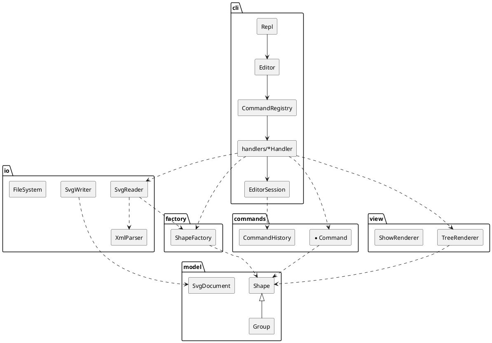

# SVG 编辑器（CLI）— PJ1 Phase 1 项目文档

> 运行：`npm install` → `npm run cli`（交互）；`npm test`（全部自动化测试）。
> 运行时 **0 依赖**，仅 `typescript` / `@types/node` 两个开发依赖。

---

## 1. 架构方案

### 1.1 模块划分

```
src/
├── model/      领域模型：图形类层次（Composite）、文档、几何快照（Memento）、错误类型
├── factory/    图形工厂：类型名 → 图形类（按名字分派的第 2 处，待重构为插件注册）
├── commands/   可撤销编辑命令（Command 模式）+ CommandHistory（undo/redo 栈）
├── io/         零依赖 XML 解析 / SVG 读写；文件系统抽象 FileSystem（IO 隔离）
├── view/       显示格式化：tree 结构树、show 属性明细（Visitor 模式）
├── cli/        REPL、分词器、CLI 命令处理器、命令注册表（按名字分派的第 1 处）、会话状态
└── main.ts     组装根（Composition Root）：创建真实文件系统与控制台输出并启动 REPL
```

| 模块 | 职责 | 不负责 |
|---|---|---|
| `model` | 图形的数据与行为（移动、缩放、设属性、容器增删子节点）、id 查找、快照与还原 | 字符串命令解析、输出格式、文件 |
| `factory` | 根据类型名创建图形（CLI 参数或 XML 属性两种来源） | 决定图形挂在哪里 |
| `commands` | 每条编辑命令一个类：执行前完整校验、执行、撤销；history 管理撤销/重做栈与 IO 锁 | 解析命令行、打印 |
| `io` | XML 文本 ↔ 节点树；节点树 ↔ `SvgDocument`；文件读写接口 | 交互、撤销 |
| `view` | 把模型渲染成 `tree` / `show` 文本 | 修改模型 |
| `cli` | 读入一行 → 分词 → 查注册表 → 处理器解析参数 → 调用 commands / io / view → 输出 | 领域规则 |



### 1.2 设计模式的选择与落地

| 模式 | 解决的问题 | 落地位置 |
|---|---|---|
| **Command**（要求） | 编辑操作需要 undo/redo，且"一条命令 = 一个撤销单元" | `commands/Command.ts` 接口（`execute()/undo()` 返回回显文本）；每条编辑命令一个类（`CreateShapeCommand`、`MoveCommand`…）；`CommandHistory` 维护 undo / redo 栈，新命令清空 redo 栈，IO 命令后加锁 |
| **Composite** | `move/scale/set/delete` 对 `<g>` 与叶子一视同仁 | `model/Shape.ts` 抽象基类；`GeometricShape` 叶子基类（Rect/Circle/Ellipse/Line/Text）；`Group` 容器递归转发 `move/scale/createMemento`；文档根 `SvgDocument` 与 `Group` 共同实现 `Container` 接口 |
| **Memento** | scale 的逆运算 `1/f` 有浮点误差；撤销应精确还原 | `Shape.createMemento()` 返回 `ShapeMemento`；叶子保存几何属性副本，`Group` 保存子孙快照的组合（`CompositeMemento`）；`MoveCommand` / `ScaleCommand` 撤销时 `restore()` |
| **Visitor** | tree 的每类图形摘要格式不同，又不想把显示逻辑塞进模型、也不允许 `switch(tag)` | `model/ShapeVisitor.ts`；`view/ShapeSummaryVisitor.ts` 为每种图形生成 `x=… y=… w=…` 摘要 |
| **Factory（注册表）** | 类型名 → 图形类 | `factory/ShapeFactory.ts`，内部一张 `Map<string, ShapeClass>`；**按名字分派第 2 处，标注待重构**（Phase 2 改为 `ShapeProvider` 插件注册） |
| **命令注册表** | 命令名 → 处理器 | `cli/CommandRegistry.ts`，一张 `Map<string, CliCommand>`；**按名字分派第 1 处，标注待重构**（可改为处理器自注册 / 插件命令） |
| **依赖倒置（端口）** | IO 隔离、可测试 | `io/FileSystem.ts` 接口 + `NodeFileSystem` / 测试用 `MemoryFileSystem`；`cli/Output.ts` 接口 + `ConsoleOutput` / 测试用 `BufferOutput` |

### 1.3 依赖方向规则

```
cli ──► commands ──► model
 │  ──► io ──► factory ──► model
 │  ──► view ──────────► model
 └──► factory
```

| 模块 | 允许依赖 | 理由 |
|---|---|---|
| `model` | （无） | 领域核心最稳定，不能被任何上层变化波及 |
| `factory` | `model` | 只知道如何构造图形 |
| `commands` | `model` | 命令只操作模型；不知道参数来自 CLI 还是将来的 GUI/agent |
| `io` | `model`, `factory` | 读入时需要按标签名构造图形 |
| `view` | `model` | 只读模型生成文本 |
| `cli` | 以上全部 | 最外层，负责组装 |
| `main.ts` | `cli`, `io` | 组装根 |

**禁止**：任何下层 import 上层（如 `model` → `commands`、`commands` → `io`、`view` → `cli`）；`io` 与 `view`、`commands` 互不依赖。
该规则由测试 `test/architecture.test.ts` 自动检查（扫描每个源文件的 `import`），违反即测试失败。

### 1.4 变化点假设

| # | 可能的变化 | 留了什么 / 为什么不留 |
|---|---|---|
| 1 | **新增图形类型**（Phase 2 的 `box` 等插件） | `ShapeFactory` 注册表 + `ShapeClass` 构造接口；新增类型只需新类 + 一行注册。目前注册是硬编码在工厂构造函数中——这是**待重构项**，Phase 2 改成 `ShapeProvider` 插件 |
| 2 | **新增命令 / 新的交互通道**（GUI、agent） | 编辑命令与 CLI 解耦：`commands` 不认识字符串参数，任何通道都可构造 `Command` 交给 `CommandHistory` |
| 3 | **新的显示方式**（例如 JSON 输出） | `ShapeVisitor` 接口；新增显示 = 新 Visitor，不改模型 |
| 4 | **存储介质变化**（浏览器、内存、网络） | `FileSystem` 接口 |
| 5 | **set 的属性白名单变化** | 白名单由每个图形类自己声明（`settableAttributes()`），不集中 switch |
| 6 | 新增 Visitor 方法的代价（新图形类型要改所有 Visitor） | **有意不处理**：Visitor 在"类型稳定、操作多变"时有利，Phase 1 类型固定；Phase 2 插件类型可提供默认 `visitGeneric` 回退 |
| 7 | 结构路径寻址（XPath 风格） | **不留**：需求明确本阶段不要求，所有命令统一走 `SvgDocument.find(id)`，将来只需替换这一处查找 |

---

## 2. 过程记录

（开发过程中逐步补充）

## 3. 一致性自查

（实现完成后填写）

## 4. 质量保证手段

（实现完成后填写）
