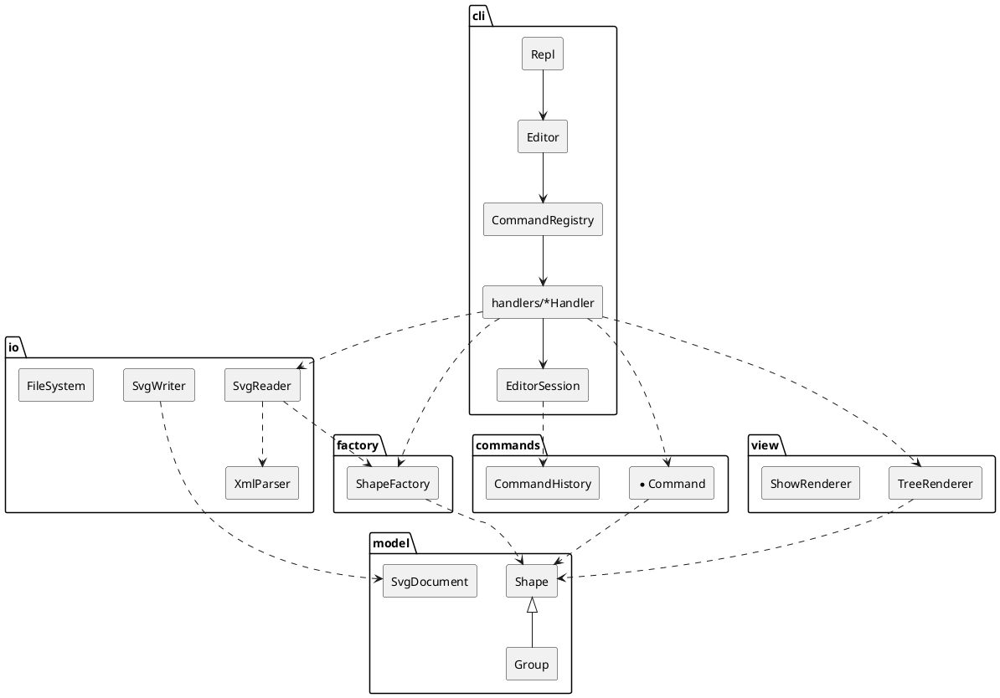

# SVG 编辑器（CLI）— PJ1 Phase 1 项目文档

> 运行：`npm install` → `npm run cli`（交互）；`npm test`（全部自动化测试）。
> 运行时 **0 依赖**，仅 `typescript` / `@types/node` 两个开发依赖。

---

## 1. 架构方案

### 1.1 模块划分

```
src/
├── model/      领域模型：图形类层次（Composite）、文档、几何快照（Memento）、错误类型
├── factory/    图形工厂：类型名 → 图形类（按名字分派的第 2 处，待重构为插件注册）
├── commands/   可撤销编辑命令（Command 模式）+ CommandHistory（undo/redo 栈）
├── io/         零依赖 XML 解析 / SVG 读写；文件系统抽象 FileSystem（IO 隔离）
├── view/       显示格式化：tree 结构树、show 属性明细（Visitor 模式）
├── cli/        REPL、分词器、CLI 命令处理器、命令注册表（按名字分派的第 1 处）、会话状态
└── main.ts     组装根（Composition Root）：创建真实文件系统与控制台输出并启动 REPL
```

| 模块 | 职责 | 不负责 |
|---|---|---|
| `model` | 图形的数据与行为（移动、缩放、设属性、容器增删子节点）、id 查找、快照与还原 | 字符串命令解析、输出格式、文件 |
| `factory` | 根据类型名创建图形（CLI 参数或 XML 属性两种来源） | 决定图形挂在哪里 |
| `commands` | 每条编辑命令一个类：执行前完整校验、执行、撤销；history 管理撤销/重做栈与 IO 锁 | 解析命令行、打印 |
| `io` | XML 文本 ↔ 节点树；节点树 ↔ `SvgDocument`；文件读写接口 | 交互、撤销 |
| `view` | 把模型渲染成 `tree` / `show` 文本 | 修改模型 |
| `cli` | 读入一行 → 分词 → 查注册表 → 处理器解析参数 → 调用 commands / io / view → 输出 | 领域规则 |



### 1.2 设计模式的选择与落地

| 模式 | 解决的问题 | 落地位置 |
|---|---|---|
| **Command**（要求） | 编辑操作需要 undo/redo，且"一条命令 = 一个撤销单元" | `commands/Command.ts` 接口（`execute()/undo()` 返回回显文本）；每条编辑命令一个类（`CreateShapeCommand`、`MoveCommand`…）；`CommandHistory` 维护 undo / redo 栈，新命令清空 redo 栈，IO 命令后加锁 |
| **Composite** | `move/scale/set/delete` 对 `<g>` 与叶子一视同仁 | `model/Shape.ts` 抽象基类；`GeometricShape` 叶子基类（Rect/Circle/Ellipse/Line/Text）；`Group` 容器递归转发 `move/scale/createMemento`；文档根 `SvgDocument` 与 `Group` 共同实现 `Container` 接口 |
| **Memento** | scale 的逆运算 `1/f` 有浮点误差；撤销应精确还原 | `Shape.createMemento()` 返回 `ShapeMemento`；叶子保存几何属性副本，`Group` 保存子孙快照的组合（`CompositeMemento`）；`MoveCommand` / `ScaleCommand` 撤销时 `restore()` |
| **Visitor** | tree 的每类图形摘要格式不同，又不想把显示逻辑塞进模型、也不允许 `switch(tag)` | `model/ShapeVisitor.ts`；`view/ShapeSummaryVisitor.ts` 为每种图形生成 `x=… y=… w=…` 摘要 |
| **Factory（注册表）** | 类型名 → 图形类 | `factory/ShapeFactory.ts`，内部一张 `Map<string, ShapeClass>`；**按名字分派第 2 处，标注待重构**（Phase 2 改为 `ShapeProvider` 插件注册） |
| **命令注册表** | 命令名 → 处理器 | `cli/CommandRegistry.ts`，一张 `Map<string, CliCommand>`；**按名字分派第 1 处，标注待重构**（可改为处理器自注册 / 插件命令） |
| **依赖倒置（端口）** | IO 隔离、可测试 | `io/FileSystem.ts` 接口 + `NodeFileSystem` / 测试用 `test/support/MemoryFileSystem`；`cli/Output.ts` 接口 + `ConsoleOutput` / `BufferOutput`（测试与回放） |

### 1.3 依赖方向规则

```
cli ──► commands ──► model
 │  ──► io ──► factory ──► model
 │  ──► view ──────────► model
 └──► factory
```

| 模块 | 允许依赖 | 理由 |
|---|---|---|
| `model` | （无） | 领域核心最稳定，不能被任何上层变化波及 |
| `factory` | `model` | 只知道如何构造图形 |
| `commands` | `model` | 命令只操作模型；不知道参数来自 CLI 还是将来的 GUI/agent |
| `io` | `model`, `factory` | 读入时需要按标签名构造图形 |
| `view` | `model` | 只读模型生成文本 |
| `cli` | 以上全部 | 最外层，负责组装 |
| `main.ts` | `cli`, `io` | 组装根 |

**禁止**：任何下层 import 上层（如 `model` → `commands`、`commands` → `io`、`view` → `cli`）；`io` 与 `view`、`commands` 互不依赖。
该规则由测试 `test/architecture.test.ts` 自动检查（扫描每个源文件的 `import`），违反即测试失败。

### 1.4 变化点假设

| # | 可能的变化 | 留了什么 / 为什么不留 |
|---|---|---|
| 1 | **新增图形类型**（Phase 2 的 `box` 等插件） | `ShapeFactory` 注册表 + `ShapeClass` 构造接口；新增类型只需新类 + 一行注册。目前注册是硬编码在工厂构造函数中——这是**待重构项**，Phase 2 改成 `ShapeProvider` 插件 |
| 2 | **新增命令 / 新的交互通道**（GUI、agent） | 编辑命令与 CLI 解耦：`commands` 不认识字符串参数，任何通道都可构造 `Command` 交给 `CommandHistory` |
| 3 | **新的显示方式**（例如 JSON 输出） | `ShapeVisitor` 接口；新增显示 = 新 Visitor，不改模型 |
| 4 | **存储介质变化**（浏览器、内存、网络） | `FileSystem` 接口 |
| 5 | **set 的属性白名单变化** | 白名单由每个图形类自己声明（`settableAttributes()`），不集中 switch |
| 6 | 新增 Visitor 方法的代价（新图形类型要改所有 Visitor） | **有意不处理**：Visitor 在"类型稳定、操作多变"时有利，Phase 1 类型固定；Phase 2 插件类型可提供默认 `visitGeneric` 回退 |
| 7 | 结构路径寻址（XPath 风格） | **不留**：需求明确本阶段不要求，所有命令统一走 `SvgDocument.find(id)`，将来只需替换这一处查找 |

---

### 1.5 需求中未明确、由本实现决定的语义

| 问题 | 决定 | 理由 |
|---|---|---|
| `scale` 是改坐标还是加 `transform` | 直接改几何属性，以原点为中心（需求原文"factor 同乘到全部几何属性"） | 与需求一致；`tree`/`show` 显示的数值即真实数值 |
| `move` 容器 | 递归平移每个子孙的几何属性，不写 `transform` | 与 scale 统一；保存后的文件无需理解 transform 就能读回 |
| `group` 新容器放在哪 | 放在**文档顺序第一个成员**的位置；成员按文档顺序进入容器 | 与 §6 示例（markers 出现在原 c1 的位置）一致 |
| `front` / `back` | front = 同级最后（最后绘制，在最上层），back = 同级第一个 | SVG 的绘制顺序即文档顺序 |
| IO 命令后的历史 | `init/read/save/canvas w h` 清空 undo/redo 栈并加锁；下一次编辑解锁 | 读入新文档后旧命令指向的对象已不存在，保留它们只会产生错误的撤销 |
| 编辑命令撤销时的回显 | 需求只给了 move/set/delete 的格式，其余自定（如 `rect#r1 creation undone`） | 每条撤销都有回显，便于脚本回放核对 |
| 读入不支持的元素（如 `<path>`） | 跳过并 `warning: skipped unsupported element <path>` | 本阶段只有 6 种类型；静默丢弃会让用户误以为保存无损 |
| 读入未建模的属性（如 `transform`、`font-size`） | 原样保留，`show` 可见，保存时写回 | 尽量无损 round-trip |
| 文件中 id 重复 | 后出现者重新分配 id 并警告 | 需求要求 id 强制唯一 |
| `set` 对容器 | 只允许 `fill/stroke/stroke-width`，写在 `<g>` 上（SVG 继承） | Composite：容器与叶子共用 `set` 命令；几何属性对 `<g>` 无意义，报 `unknown attribute` |

已知限制：`move/scale` 对带 `transform` 的外部 `<g>` 仍直接修改子图形坐标（视觉效果会被该 transform 缩放）；保存时 `viewBox` 总是写为 `0 0 w h`。

---

## 2. 过程记录

本项目用 Claude Code（Claude Opus 5.5）协作完成。以下是有代表性的讨论与迭代，按时间顺序。

**① 先读需求、列出交付物，再动手。** 开始前让 AI 通读 `doc/requirements.md`，整理"做什么 / 交什么 / 需要我提供什么"。AI 指出截止时间实际只剩 5 天（而不是"两周"），并把需求中的硬约束（一类一文件、禁止 `switch(tag)`、只允许两处按名字分派且须标注待重构）单独列出——这些后来都变成了 `test/architecture.test.ts` 里的自动检查，而不是靠人工记忆。

**② 环境问题：AI 的第一个方案不可行，换路径解决。**
- AI 想直接在 E 盘建目录，被沙箱拒绝；改为由我在文件选择器里授予 E 盘目录访问权限。
- 推送到 GitHub 时，`ssh -T git@github.com` 一直挂起。AI 判断是 22 端口被网络屏蔽，改用 GitHub 官方的 443 端口 SSH（`ssh://git@ssh.github.com:443/chaoshou133/SVG.git`），验证通过，无需安装其他工具。

**③ "尽量 0 依赖"的取舍。** 我要求零依赖。AI 的处理：运行时零依赖（自己写 `XmlParser`），只保留 `typescript` 和 `@types/node` 两个开发依赖；测试用 Node 自带的 `node:test`，不引入 vitest/jest。另外 npm 上 TypeScript 最新版已是 7.x（Go 重写版，编译选项有变化），AI 选择锁定 `~5.9.3` 以求稳定。

**④ 撤销方案：从"逆运算"改为 Memento。** 设计时最直接的思路是 `move` 的撤销做 `move(-dx,-dy)`、`scale` 的撤销做 `scale(1/f)`。评估后发现 `scale 3` 再 `scale 1/3` 会得到 `0.9999999` 之类的值，所以改为执行前保存几何快照、撤销时恢复（`GeometryMemento` / `CompositeMemento`），并用测试 `memento restores geometry exactly` 固定下来。

**⑤ 需求本身的不一致：§6.1 的 tree 没有严格对齐。** 实现 tree 时，AI 按 §6 示例反推出对齐规则："详情列 = 最长的 `前缀 + ref` + 2"。逐字回放 §6 的会话能完全对上，但 §6.1 的流程图示例里有两行比其他行多一个空格，说明原文是手工排版的。决定：§6 逐字比较；§6.1 比较时把连续空白压缩成一个，并在测试里写明原因。

**⑥ 读入文件时自动补 id 的陷阱。** 如果按出现顺序给无 id 的 `<rect>` 分配 `rect1`，而文件后面恰好有一个 `id="rect1"`，就会产生重复 id。AI 改为两遍扫描：先收集文件中所有显式 id，生成 id 时避开它们（`IdAllocator`）；同时处理"文件里本身就有重复 id"的情况。两种情况都有测试。

**⑦ 带引号的 `"in"`。** `create text t 0 0 "in" in box` 中，第一个 `in` 是文字内容，第二个是关键字。只看分词后的字符串无法区分，所以 `Token` 记录了 `quoted` 标志，只有不带引号的 `in` 才被当作关键字。

**⑧ 测试失败时，先判断是测试错还是实现错。** 开发中先后有 5 个测试失败，逐一检查后发现全是测试写错了：结构指纹漏了 text 内容；`front bg` 时 bg 本来就在最前面；两处手算的期望值数错了；还有一处 `addto` 的期望错误信息写错了。其中 `addto` 那条，实现返回的 `no such container` 才符合需求 §4.2 的约定（第一个参数是容器）。所以最后修改的是测试，实现没有改。

**⑨ 代码精简。** `SvgReader` 中最初为了绕过 `Shape | null` 写了一个复杂的类型断言，评审时改成直接判断 null。

> 📝 **我的补充**（作者在此记录自己对 AI 输出的判断、修改与思考）：
>
> - …

---

## 3. 一致性自查

### 3.1 模块划分：实际目录与方案是否一致？

| 方案中的模块 | 实际 | 一致 |
|---|---|---|
| `model/` | `Shape`、`GeometricShape`、`Rect/Circle/Ellipse/Line/Text`、`Group`、`SvgDocument`、`Container`、`ChildList`、`ShapeMemento`/`GeometryMemento`/`CompositeMemento`、`ShapeVisitor`、`Num`、`EditorError` | ✅ |
| `factory/` | `ShapeFactory`、`ShapeClass` | ✅ |
| `commands/` | `Command`、`CommandHistory`、9 个命令类 + `Placement` | ✅（见修订 R1） |
| `io/` | `XmlParser`、`XmlElement`、`XmlText`、`SvgReader`、`SvgWriter`、`IdAllocator`、`FileSystem`、`NodeFileSystem` | ✅（见修订 R2） |
| `view/` | `TreeRenderer`、`ShowRenderer`、`ShapeSummaryVisitor` | ✅ |
| `cli/` | `Repl`、`Editor`、`EditorSession`、`Tokenizer`、`Token`、`CommandRegistry`、`CliCommand`、`Output`/`ConsoleOutput`/`BufferOutput`、`handlers/` 下 19 个处理器 | ✅ |

**修订记录**
- **R1**：`commands/Placement` 不在最初方案里。`group/ungroup/addto/front/back` 都需要"摘下图形、记住原位置、撤销时放回"，于是抽成一个类，避免五处重复。
- **R2**：最初方案把 `MemoryFileSystem` 列在 `io`。实现时把它放到了 `test/support/`，因为它只给测试用，不应该进入产品代码。方案表格已同步修改。

### 3.2 依赖方向：规则有没有被违反？

- **自动检查**：`test/architecture.test.ts` 扫描 `src/` 下每个文件的相对 import，按 §1.3 的表格校验，当前**0 违规**。同一个测试还检查了：运行时代码只 import `node:` 内置模块；每个文件只导出一个与文件同名的类或接口；全仓库没有 `switch`；两处按名字分派都带有 `TODO(refactor` 标注。
- **抽样人工核对**：
  - `commands/MoveCommand.ts` 只 import `model/*`。✅
  - `io/SvgReader.ts` import `factory/ShapeFactory`（仅类型）和 `model/*`，不认识任何具体图形类。✅
  - `view/TreeRenderer.ts` 只 import `model/*` 和同模块的 `ShapeSummaryVisitor`。✅
  - `model/` 下没有任何文件 import 其他模块。✅
  - `cli/handlers/CreateHandler.ts` → `commands/CreateShapeCommand`，属于允许的 cli → commands。✅

---

## 4. 质量保证手段

1. **对照需求的回放测试（功能完整性）**：`test/fixtures/` 里放着需求 §6 和 §6.1 的完整会话原文，`test/transcript.test.ts` 逐条执行其中的命令，并逐行比对输出。§6 是逐字节比对，包括 tree 的列对齐、warning 和 error 文本；§6.1 只忽略空白对齐，另外还会检查保存出来的 SVG 内容。
2. **命令覆盖**：命令表里全部 20 条命令（含 front/back，外加 exit），以及 §4.2 中本阶段适用的 10 种错误信息，在 `cli.test.ts` 和 `commands.test.ts` 里都有用例。`cannot ungroup composite shape` 属于 `box` 插件，本阶段不适用；`create box` 按要求报 `unknown shape type`，这一点也有测试。
3. **撤销的往返性质测试**：`commands.test.ts` 中的 `roundTrip` 对每种编辑命令做"执行 → 撤销 → 重做"，用结构指纹（id、嵌套、全部属性、文本）断言撤销后与执行前完全一致、重做后与执行后完全一致，重做时的回显也与首次执行相同。
4. **失败不改变状态**：12 种失败场景逐一断言：执行失败后文档指纹不变，undo 栈也不受影响。
5. **IO round-trip**：读入 → 写出 → 再读入 → 再写出，两次写出的文本完全相同；另外覆盖了实体转义、CDATA、DOCTYPE、注释、格式错误时报告行号。
6. **架构规则可执行**：见 §3.2，违反依赖方向或一类一文件的规则时 `npm test` 会失败，不靠人工自觉。
7. **编译期**：TypeScript `strict` + `noImplicitOverride` + `noUnused*`。
8. **人工冒烟**：`node dist/src/main.js < examples/flowchart.txt` 生成 `examples/flowchart.svg`，在浏览器中打开，确认渲染正确（节点、文字、连线、下移后的节点 2）。

当前结果：`npm test` → **69 个测试全部通过**。
